# Highly available web app on AWS (Terraform)

A small Node.js app running on AWS the way a real production app should: two availability zones, load balancer with HTTPS, auto scaling, private database, no passwords in code.
Everything is Terraform. CI/CD workflows are GitHub Actions.

It was live at https://devops-task.deepboda.in from 22 Oct to 2 Nov 2026, then I tore it down. Screenshots below are from the live stack.

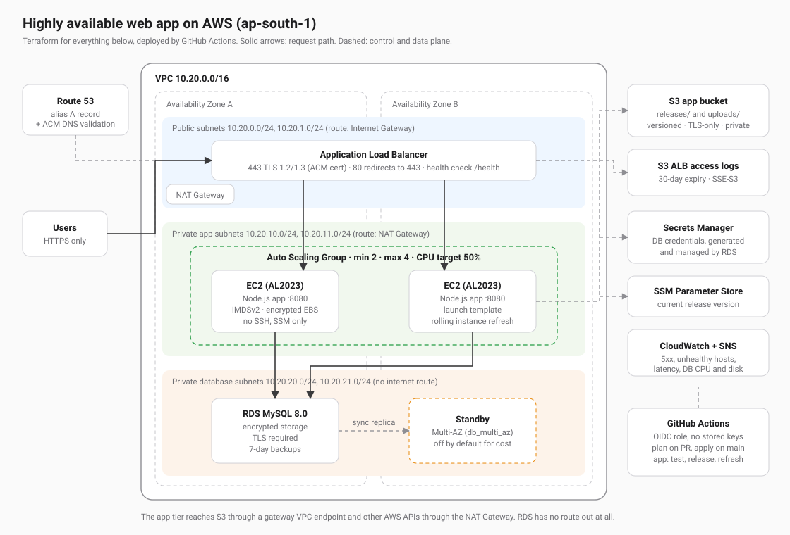

## How it works

Internet -> ALB (HTTPS) -> EC2 instances in an Auto Scaling Group -> RDS MySQL

- Only the ALB is public. Instances and database are in private subnets.
- Two AZs (ap-south-1a and ap-south-1b). ASG keeps 2 instances, can go to 4 on CPU.
- If an instance dies, ALB stops sending traffic to it and ASG starts a new one.
- Database password is made by RDS and kept in Secrets Manager. App reads it at runtime.
- ALB access logs go to S3. CloudWatch alarms for 5xx, unhealthy targets, latency, db cpu, db storage.

## What is where

| Part | What | Folder |
|---|---|---|
| Network | VPC, public / app / db subnets in 2 AZs, NAT, S3 endpoint | `infra/modules/network` |
| Security | security groups, one per tier, chained ALB -> app -> db | `infra/modules/security` |
| Load balancer | ALB, HTTPS with ACM cert, HTTP redirects to HTTPS | `infra/modules/alb` |
| Certificate | ACM cert, DNS validation (Route 53 or your own DNS) | `infra/modules/certificate` |
| Compute | launch template, ASG 2 to 4, CPU scaling, rolling refresh | `infra/modules/compute` |
| Database | RDS MySQL 8.4, encrypted, TLS required, backups | `infra/modules/database` |
| Storage | app bucket (versioned) and ALB logs bucket | `infra/modules/storage` |
| Monitoring | CloudWatch alarms to SNS | `infra/modules/monitoring` |
| State and CI role | S3 state bucket, GitHub OIDC deploy role | `bootstrap/` |
| App | Node.js, shows which instance and AZ answered, checks db and S3 | `app/` |
| Pipelines | terraform.yml (fmt, validate, tflint, plan, apply) and app.yml (test, package, release, refresh) | `.github/workflows` |

## Run it

Need Terraform 1.10+, AWS CLI logged in, and a domain where you can add DNS records.

```bash
# 1. once: state bucket + github deploy role
cd bootstrap
terraform init
terraform apply -var github_repo=<owner>/<repo>

# 2. the stack
cd ../infra
cp backend.hcl.example backend.hcl            # bucket = state_bucket from step 1
cp terraform.tfvars.example terraform.tfvars  # set domain_name
terraform init -backend-config=backend.hcl
terraform apply
```

DNS: with `create_dns_zone = true` Terraform makes a Route 53 zone, you add its 4 NS records at your domain. If DNS stays at your provider (I used GoDaddy), set `create_dns_zone = false` and add 2 CNAMEs: the `certificate_validation_records` output, and your domain pointing to `alb_dns_name`.

Then release the app (push to `app/` on main, or run the app workflow).

## Which command when

| Command | When |
|---|---|
| `terraform apply` in `bootstrap/` | Only once per account. Makes state bucket and deploy role. |
| `terraform apply` in `infra/` | First deploy, or after changing anything in `infra/`. |
| `terraform plan` in `infra/` | Before apply, or to see if AWS still matches the code. |
| `./scripts/check.sh` | Anytime the stack is up. Tests https, health, both AZs, targets, ASG, RDS, alarms, logs. |
| `./scripts/failover-test.sh` | To prove HA. Kills one instance, keeps calling the site, waits till ASG replaces it. |
| `terraform destroy` in `infra/` | To remove everything. Empty the 2 buckets first, they are not force deleted. |

## Variables

- `infra/terraform.tfvars` (not in git, example is `terraform.tfvars.example`): domain, instance size, ASG sizes, db size, Multi-AZ, backups, alarm email.
- `infra/backend.hcl` (not in git): state bucket name. State locking is S3 native (`use_lockfile`), no DynamoDB.
- GitHub repo variables for the pipelines: `AWS_DEPLOY_ROLE_ARN`, `TF_STATE_BUCKET`, `DOMAIN_NAME`, `AWS_REGION`, optional `ALARM_EMAIL`, `CREATE_DNS_ZONE`, `DB_BACKUP_RETENTION_DAYS`.
- No AWS keys anywhere. GitHub gets short lived creds through OIDC, instances use their IAM role.

More detail on how I built it in [SETUP.md](SETUP.md).

## Security in short

- Only ALB is public, db subnets have no internet route.
- Security groups: internet -> ALB 443 (80 only redirects), ALB -> app port, app -> MySQL 3306. Nothing else.
- TLS 1.2/1.3 on the ALB, db refuses non TLS connections, app verifies the RDS cert.
- Encryption at rest on RDS, EBS, S3.
- IAM is tight: instance role reads one secret, one SSM parameter, two S3 prefixes. Deploy role trusts only this repo.
- IMDSv2 only, no SSH, no key pair. Shell access through SSM Session Manager.

## Tested on the live stack

- http redirects to https, `/health` and `/health/db` ok, MySQL 8.4.11 over TLS
- 10 requests split 5 / 5 across ap-south-1a and ap-south-1b
- Killed one instance while calling the site every second: 43 requests, 0 failed, new instance healthy in 74s
- All 5 alarms OK, ALB logs arriving in S3
- `terraform plan` before teardown showed only a newer Amazon Linux AMI, nothing else drifted
- Teardown: 71 resources destroyed in infra, 3 in bootstrap, state bucket deleted, nothing left

## Screenshots

Live app (after the failover test, the new instance is answering)

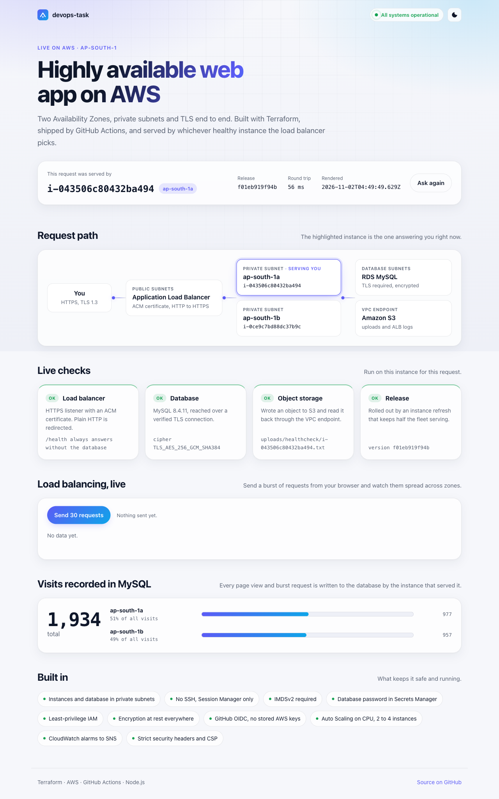

AWS console, 23 Oct

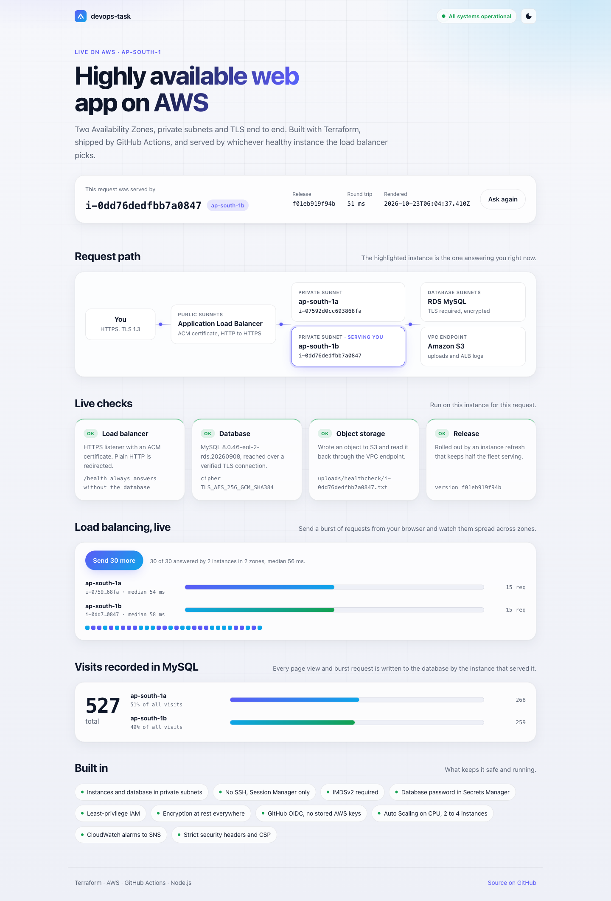
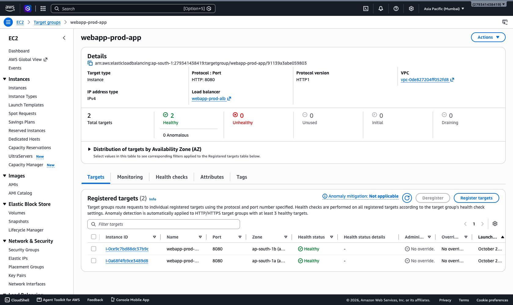
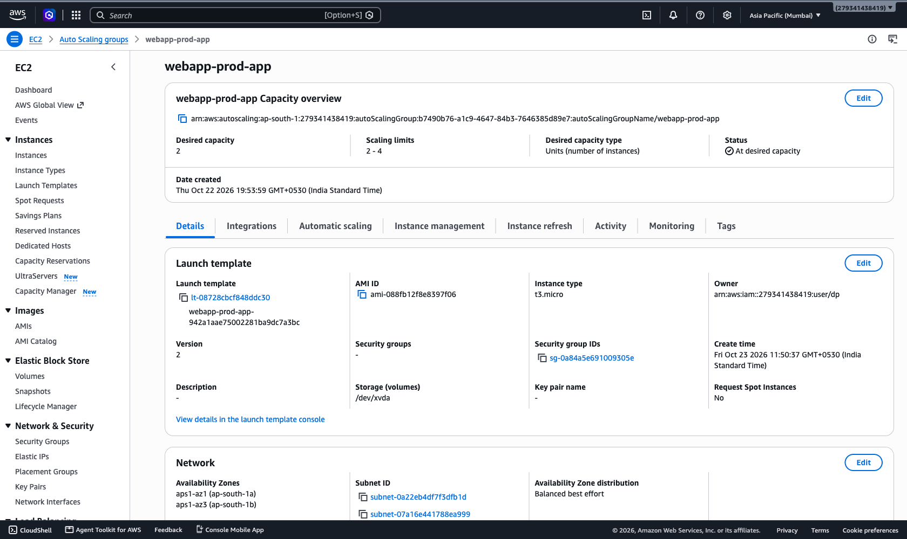
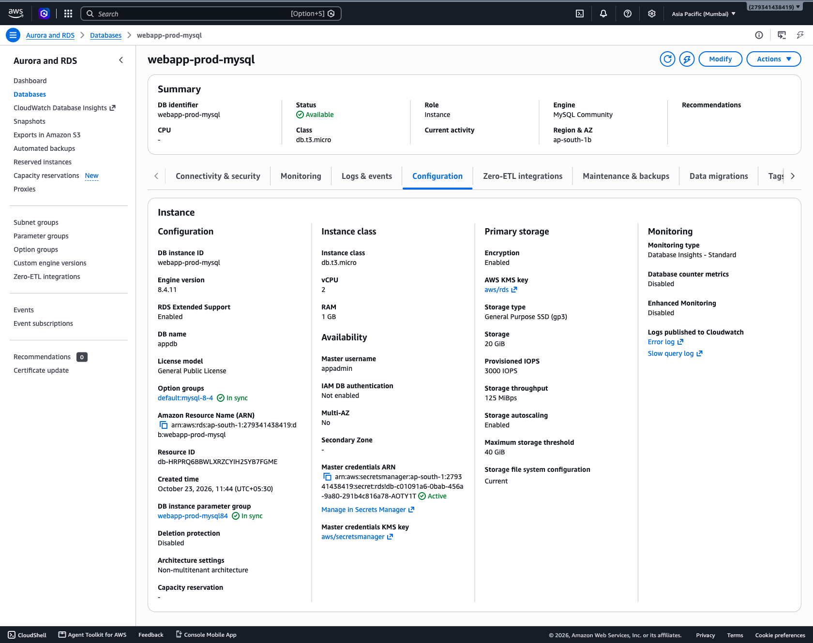
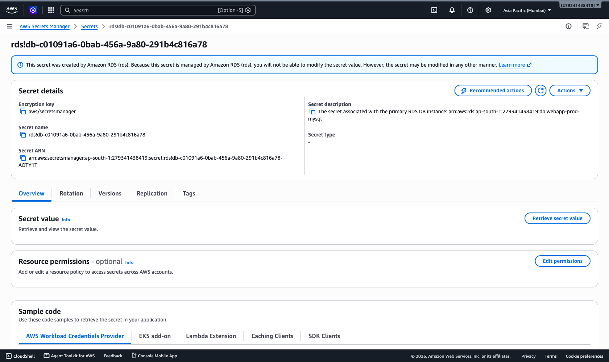
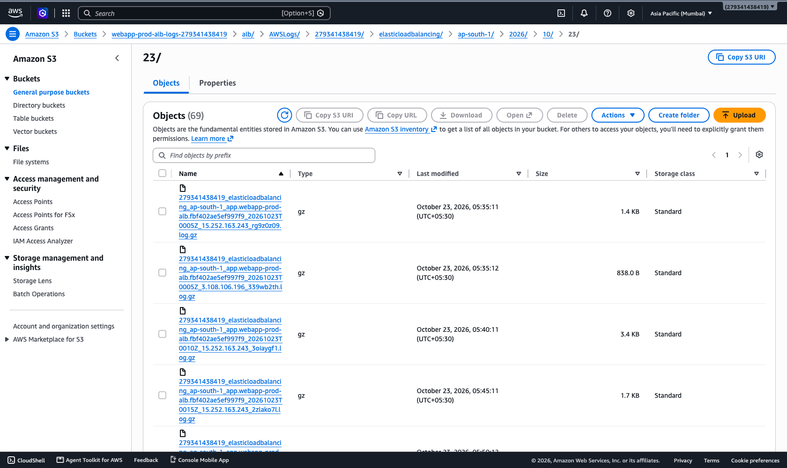
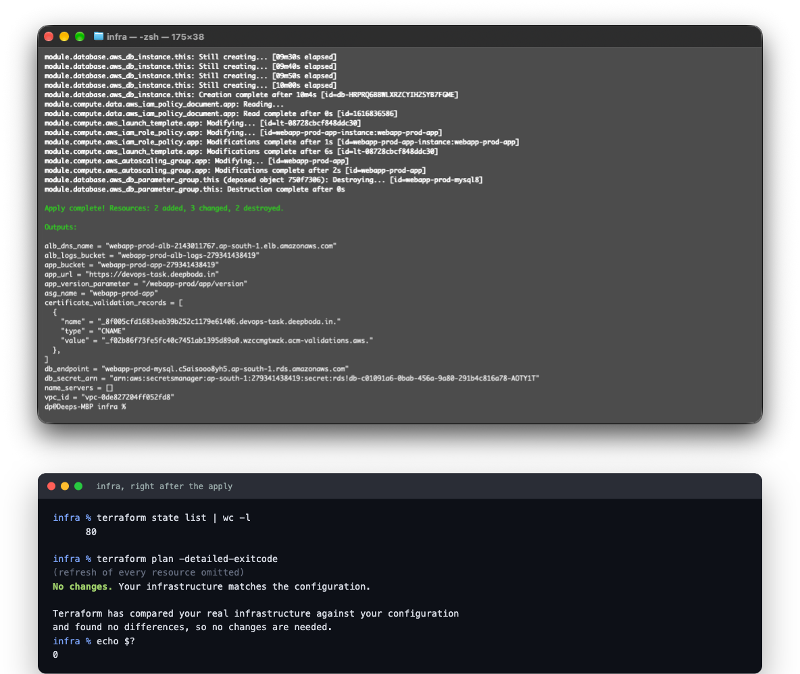

Live checks, failover test and teardown, 2 Nov (text versions in [docs/logs](docs/logs))

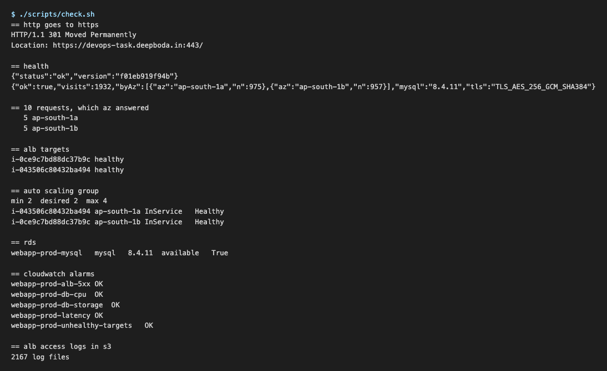
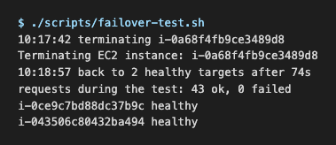
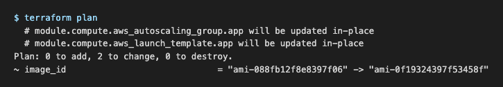
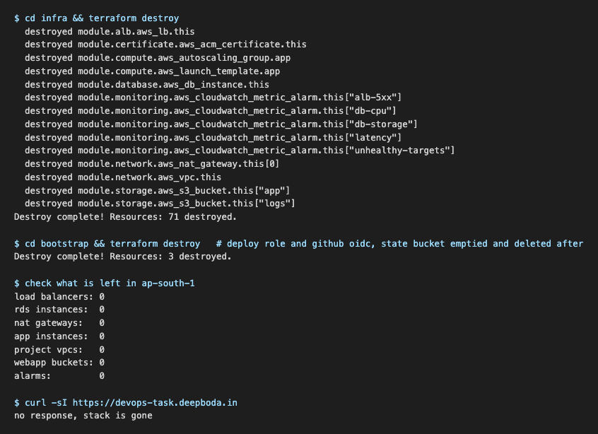

Pipelines (GitHub had Actions blocked on my account when I deployed, not a code issue, so releases were run by hand with the same steps)

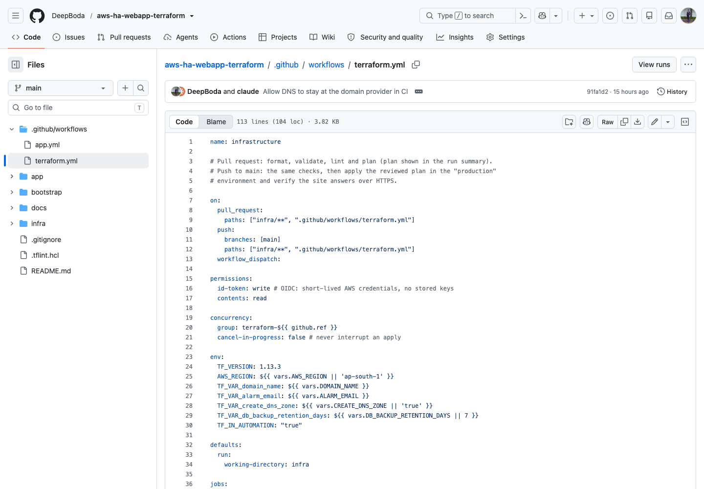
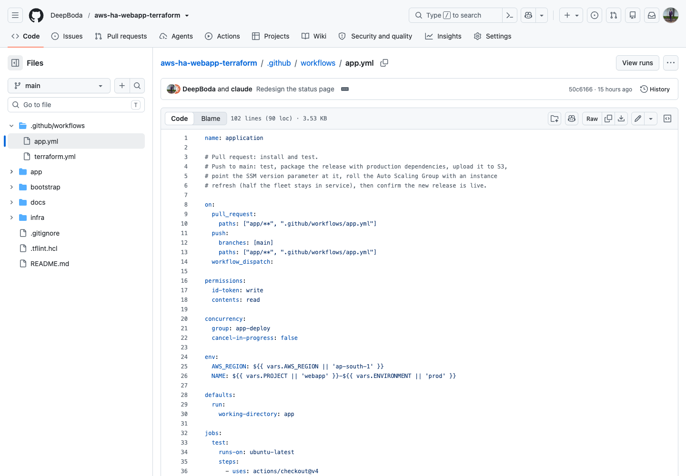

## For real production I would change

- `db_multi_az = true`, `nat_gateway_per_az = true`, `db_deletion_protection = true`
- 7+ days of db backups (Free plan account allowed only 1)
- WAF on the ALB
- Alarm email or Slack on the SNS topic

## Cost

Around 3 to 4 USD a day in ap-south-1 with defaults, mostly NAT Gateway and ALB. Destroy it when not needed.
