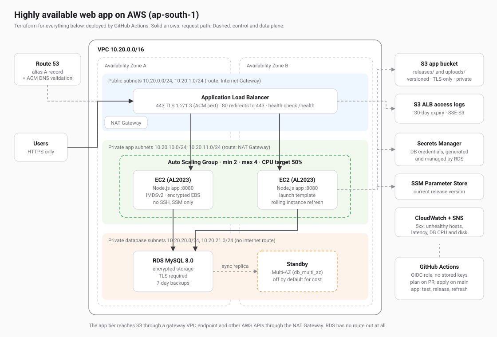

# Highly available web app on AWS with Terraform and GitHub Actions

A three-tier web application on AWS, built entirely with Terraform and deployed by GitHub Actions:

**Internet → Application Load Balancer (HTTPS) → Auto Scaling EC2 instances → RDS MySQL**, with ALB access logs in S3.

Everything runs across two Availability Zones. Public traffic only reaches the load balancer; the instances and the database sit in private subnets.



## What is in it

| Area | How it is done | Where |
| --- | --- | --- |
| Networking | VPC with public, private-app and private-database subnets in each AZ, Internet Gateway, NAT Gateway, separate route tables per tier, gateway VPC endpoint for S3 | `infra/modules/network` |
| Compute | EC2 Auto Scaling Group (min 2, max 4) from a launch template, Amazon Linux 2023, CPU target tracking, rolling instance refresh | `infra/modules/compute` |
| Load balancing | Application Load Balancer, HTTPS listener with an ACM certificate (TLS 1.2/1.3 policy), HTTP to HTTPS redirect, health checks | `infra/modules/alb` |
| Certificate and DNS | ACM certificate validated over DNS in a Route 53 zone, alias record to the ALB | `infra/modules/certificate` |
| Database | RDS MySQL 8.0 in private subnets, encrypted storage, TLS required, automated backups, optional Multi-AZ | `infra/modules/database` |
| Secrets | Database password generated by RDS and stored in Secrets Manager; the app reads it at runtime with its instance role | `infra/modules/database`, `app/server.js` |
| IAM | Instance role limited to one secret, one SSM parameter and two S3 prefixes; GitHub deploy role through OIDC, limited to this repository | `infra/modules/compute`, `bootstrap` |
| Storage | S3 bucket for application storage (versioned) and a bucket for ALB access logs (30-day expiry), both private and TLS-only | `infra/modules/storage` |
| CI/CD | Terraform pipeline (fmt, validate, tflint, plan on PRs, apply on `main`, HTTPS health check) and an app pipeline (test, package, release, rolling refresh, live check) | `.github/workflows` |
| Monitoring | CloudWatch alarms for target 5xx, unhealthy hosts, latency, database CPU and free storage, sent to SNS | `infra/modules/monitoring` |
| Application | Small Node.js service that shows the serving instance and AZ, checks MySQL over TLS and writes to S3 | `app/` |

## Repository layout

```
bootstrap/            one-time: Terraform state bucket + GitHub OIDC deploy role
infra/                the stack
  modules/
    network/          VPC, subnets, IGW, NAT, routes, S3 endpoint
    security/         security groups, one tier at a time
    storage/          app bucket and ALB log bucket
    database/         RDS MySQL, subnet group, parameter group
    certificate/      Route 53 zone, ACM certificate and validation
    alb/              load balancer, listeners, target group
    compute/          IAM role, launch template, ASG, scaling policy, boot script
    monitoring/       CloudWatch alarms and SNS topic
app/                  Node.js application and tests
.github/workflows/    terraform.yml (infrastructure), app.yml (application)
docs/                 architecture diagram and deployment screenshots
```

## Deploying

Requirements: Terraform 1.10 or newer, AWS CLI with credentials for the target account, a domain you can add DNS records to.

### 1. Bootstrap (once)

Creates the state bucket and the GitHub deploy role.

```bash
cd bootstrap
terraform init
terraform apply -var github_repo=<owner>/<repo>
```

Note the `state_bucket` and `deploy_role_arn` outputs.

### 2. Configure and apply the stack

```bash
cd infra
cp backend.hcl.example backend.hcl            # set bucket = <state_bucket>
cp terraform.tfvars.example terraform.tfvars  # set domain_name
terraform init -backend-config=backend.hcl
terraform apply -target=module.certificate.aws_route53_zone.this
terraform output name_servers
```

Add the four `name_servers` as NS records for `domain_name` at the parent domain's DNS provider. This delegates just that hostname to Route 53. Then:

```bash
terraform apply
```

Terraform validates the certificate, creates the rest and prints `app_url`. Until the first application release, the instances serve a placeholder page so the health checks pass.

If you would rather not delegate, set `create_dns_zone = false`, add the `certificate_validation_records` output as CNAMEs, and point a CNAME for `domain_name` at `alb_dns_name`.

### 3. Connect GitHub Actions

Repository variables (Settings → Secrets and variables → Actions → Variables):

| Variable | Value |
| --- | --- |
| `AWS_DEPLOY_ROLE_ARN` | `deploy_role_arn` from bootstrap |
| `TF_STATE_BUCKET` | `state_bucket` from bootstrap |
| `DOMAIN_NAME` | the app hostname |
| `AWS_REGION` | `ap-south-1` |
| `ALARM_EMAIL` | optional, for alarm emails |

Create an environment called `production` (add required reviewers for a manual approval before apply). No AWS keys are stored in GitHub: each run gets short-lived credentials through OIDC.

### 4. Release the application

Push a change under `app/` to `main`, or run the **application** workflow by hand. It tests the app, uploads `releases/app-<sha>.tgz` to S3, writes the version to SSM, starts a rolling instance refresh that keeps at least half the instances in service, and then checks that the live site serves the new version.

## CI/CD

**infrastructure** (`.github/workflows/terraform.yml`)

- Pull request: `terraform fmt -check`, `validate`, `tflint` with the AWS ruleset, then `plan`. The plan summary is written to the run page.
- Push to `main`: the same checks, then `apply` of that exact plan in the `production` environment, then a check that `https://<domain>/health` returns 200.

**application** (`.github/workflows/app.yml`)

- Pull request: `npm ci`, tests, `npm audit` for high-severity issues.
- Push to `main`: package with production dependencies, upload to S3, update the version parameter, rolling instance refresh, then confirm the new version is served consistently.

## Security

- Only the ALB is public. Instances and the database have no public IPs; the database subnets have no route to the internet.
- Security groups chain the tiers: the internet reaches the ALB on 443 (80 only redirects), the ALB reaches the app port, the app reaches MySQL on 3306. Nothing else is open, and the VPC's default security group is emptied.
- HTTPS everywhere a client connects: ACM certificate, TLS 1.2/1.3 policy, HTTP redirected, invalid headers dropped. The database refuses unencrypted connections (`require_secure_transport`) and the app verifies the RDS certificate.
- Encryption at rest: RDS storage, EBS volumes, S3 buckets and the state bucket.
- No credentials in code, state or user data. RDS generates the master password and keeps it in Secrets Manager; the app reads it at runtime.
- Least-privilege IAM. The instance role can read one secret, read one parameter, read `releases/` and read/write `uploads/` in one bucket. The GitHub role is trusted only for this repository, and its IAM rights only cover roles and instance profiles named after the project.
- Instances require IMDSv2, run the app as an unprivileged systemd user with a read-only filesystem, and have no SSH or key pair. Shell access goes through SSM Session Manager, authorised by IAM.
- S3 buckets block all public access, enforce bucket-owner ownership and deny non-TLS requests.

## High availability

- Two AZs for every tier. The ASG keeps at least two instances and replaces any that fail the ALB health check.
- `/health` does not depend on the database, so a short database interruption does not cause instances to be replaced. `/health/db` reports database readiness separately.
- Deployments are rolling instance refreshes with at least 50% healthy capacity.
- For production, set `db_multi_az = true` (synchronous standby in the second AZ, automatic failover), `nat_gateway_per_az = true` (no single NAT), and `db_deletion_protection = true`.

## Validation checklist

After `apply` and the first release:

```bash
curl -I http://<domain>                 # 301 to https
curl -s https://<domain>/health         # {"status":"ok",...}
curl -s https://<domain>/health/db      # {"ok":true,...,"tls":"TLS_AES_..."}
curl -s https://<domain>/api/info       # instance, AZ, version, db and storage checks
for i in $(seq 1 10); do curl -s https://<domain>/api/info | jq -r .instance.az; done   # both AZs
aws elbv2 describe-target-health --target-group-arn <arn>                              # all healthy
aws s3 ls s3://<alb_logs_bucket>/alb/ --recursive | head                               # access logs arriving
```

Screenshots of a deployed run are in [`docs/screenshots`](docs/screenshots).

## Cost and teardown

With the defaults (2 × t3.micro, single NAT Gateway, single-AZ db.t3.micro, one ALB) the stack costs roughly 3 to 4 USD a day in ap-south-1, most of it the NAT Gateway and the ALB.

```bash
cd infra && terraform destroy
```

The state bucket in `bootstrap` has `prevent_destroy` on purpose; remove that line before destroying it.
