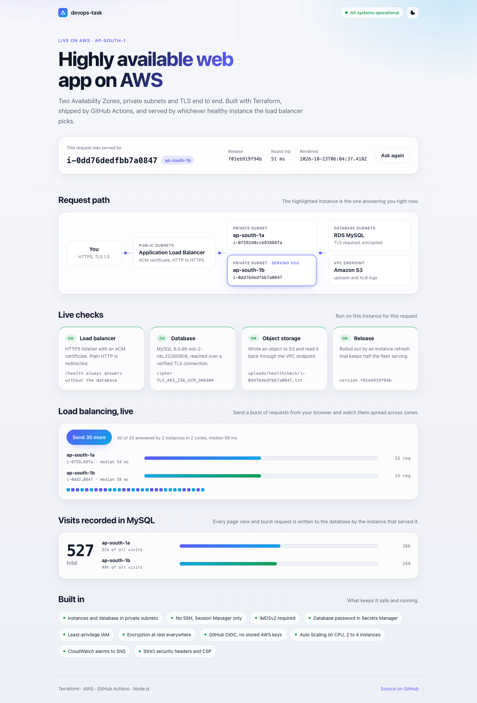
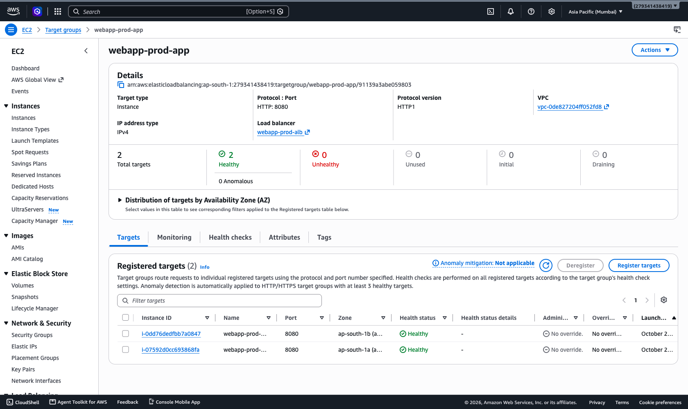
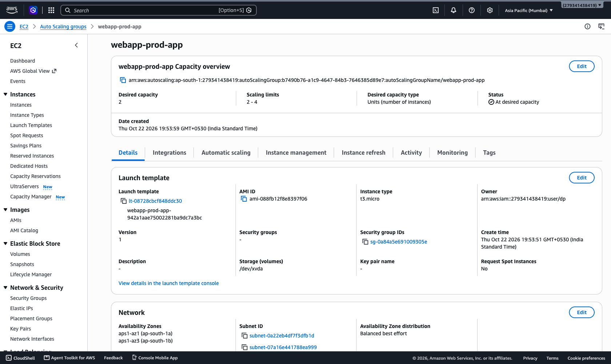
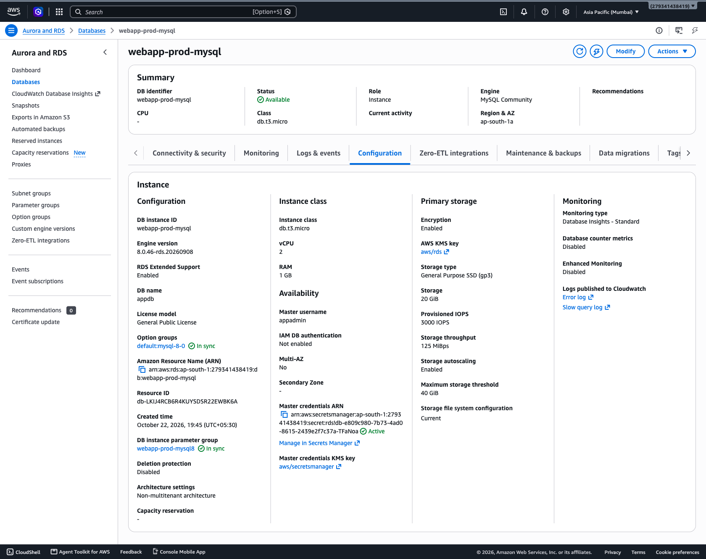
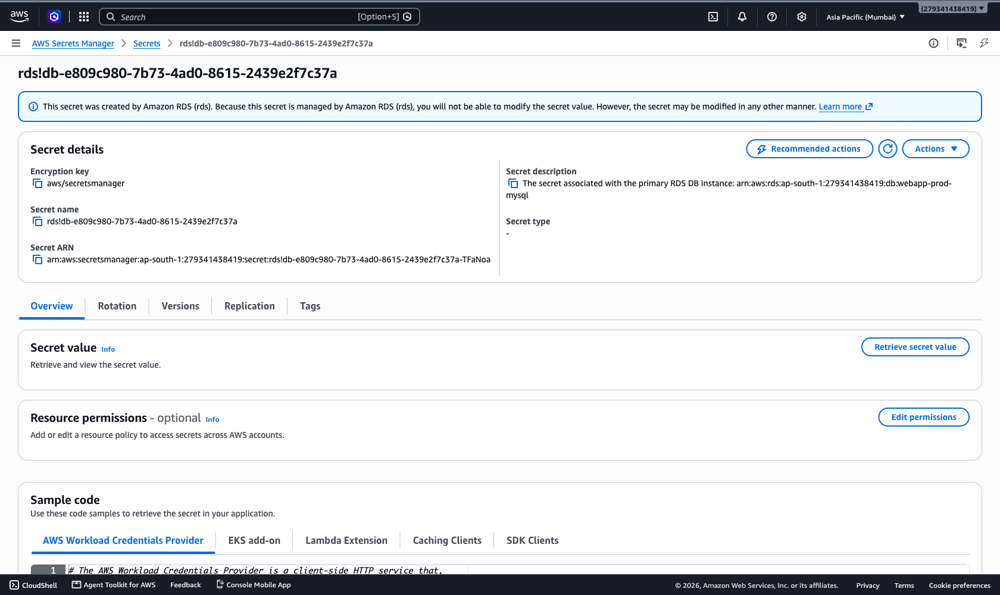
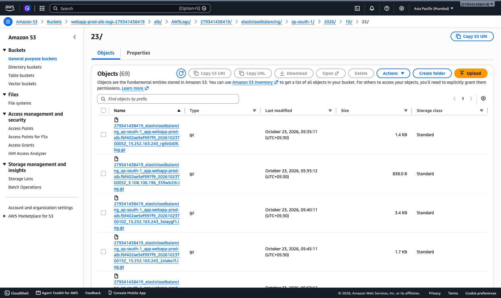
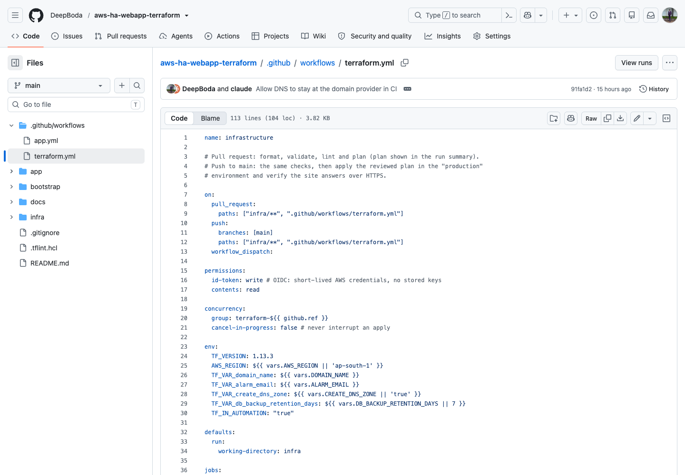
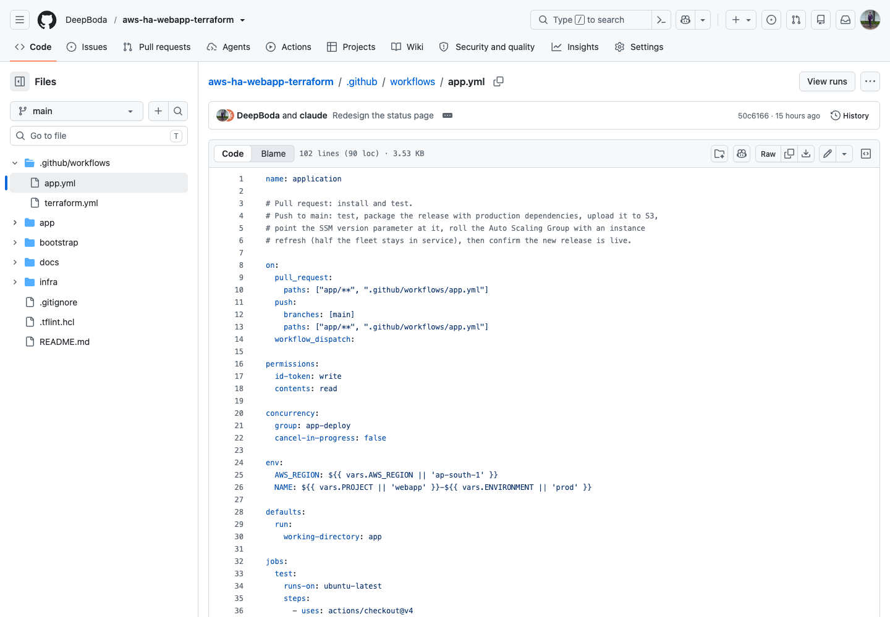
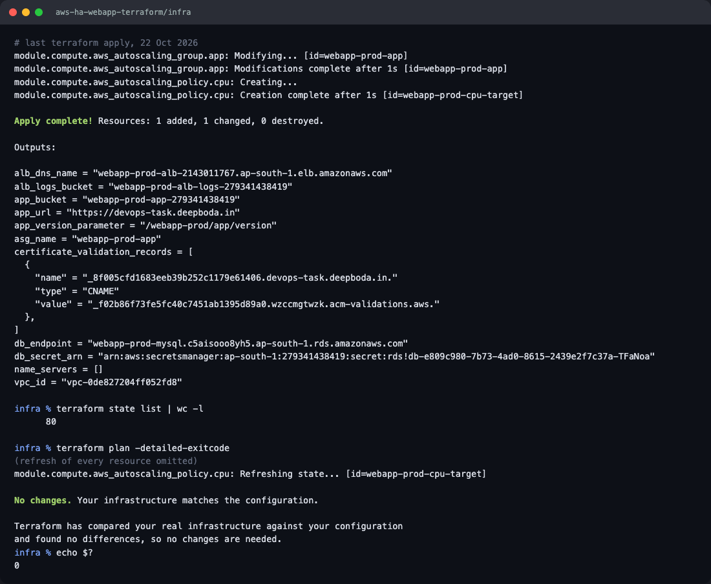

# Deployment screenshots

Captured from the live deployment in ap-south-1 on 23 Oct 2026.

### 1. The app over HTTPS
Serving instance and AZ, database over TLS, S3 write and read, and a 30 request burst split across both zones.

### 2. Target group
Both instances healthy, one in each AZ.

### 3. Auto Scaling Group
2 to 4 instances from the launch template, spread over ap-south-1a and ap-south-1b.

### 4. RDS MySQL
Encrypted storage, credentials managed in Secrets Manager, custom parameter group that requires TLS.

### 5. Secrets Manager
The database master password, generated and owned by RDS. It never appears in code, state or user data.

### 6. ALB access logs in S3
Log files arriving every few minutes under `alb/AWSLogs/`.

### 7 and 8. GitHub Actions workflows
GitHub has Actions disabled on this account at the moment (a support ticket is open; it is not related to the code), so there are no run screenshots yet. The workflows are below, and releases were run by hand with the same steps.

### 9. Terraform
Output of the last apply, then a fresh plan against the live account: no changes, so the infrastructure matches the code.

